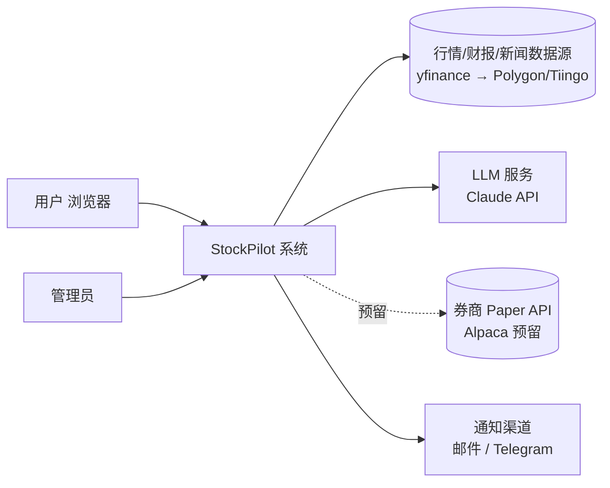
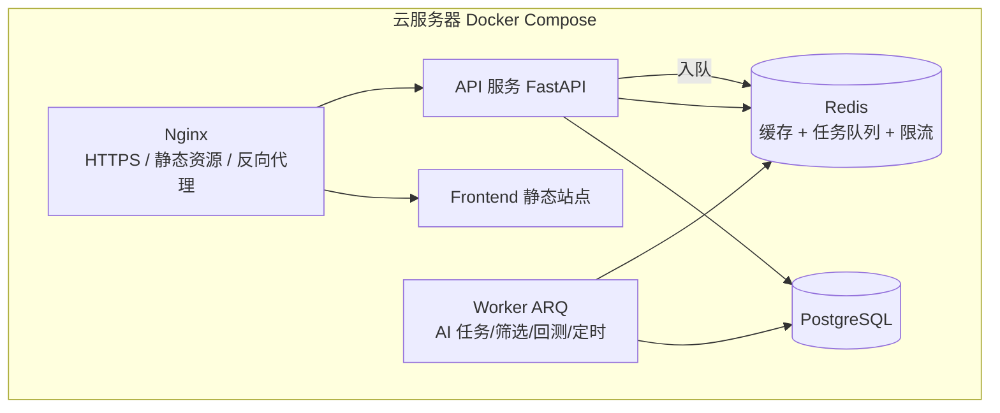
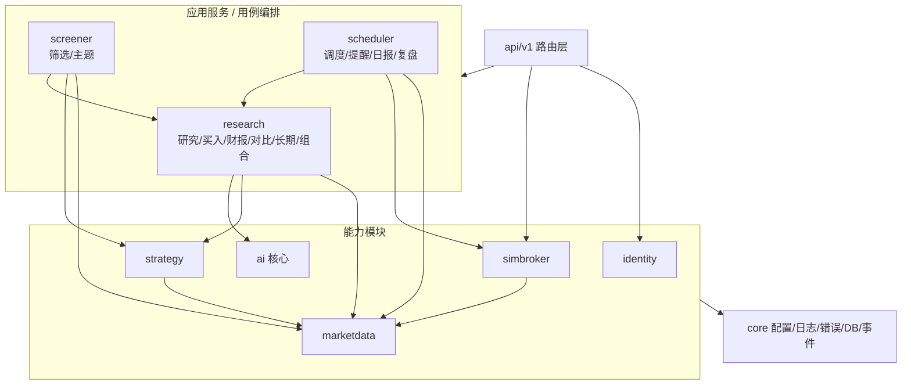
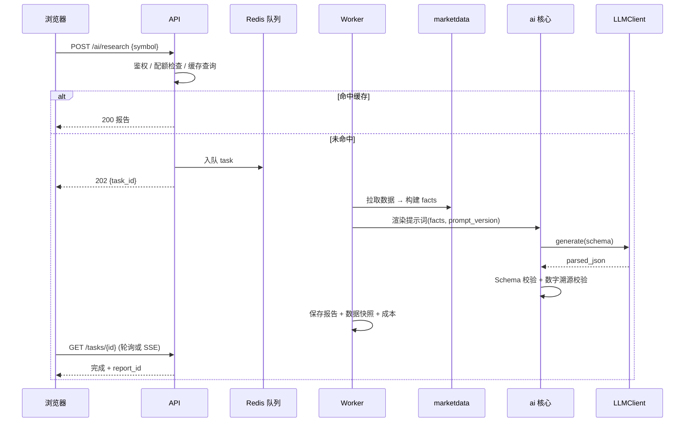
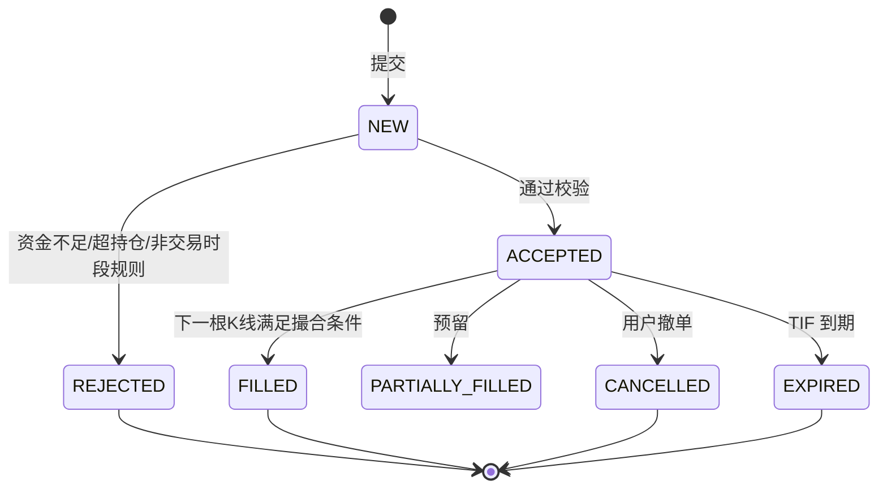

# 02 架构设计

## 1. 架构风格

**模块化单体 + 端口与适配器（六边形架构）**

- 一个可部署单元，内部按业务能力划分模块，模块边界严格。
- 业务核心不依赖任何外部系统；外部系统（数据源、券商、LLM、通知）通过**端口（Protocol）**接入，由**适配器**实现。
- 将来某模块需要独立扩容（如 AI 工作进程），可沿模块边界拆出，不必重写。

不选微服务的理由：团队规模小，分布式复杂度（部署、一致性、调试）远大于收益。见 [ADR-001](09-adr.md)。

## 2. 系统上下文（C4 L1）



## 3. 容器视图（C4 L2）与部署



- **API 与 Worker 同一镜像、不同启动命令**，共享代码。
- 长耗时操作（AI 分析、批量筛选、回测）一律进 Worker，API 立即返回任务 ID。
- 备份：Postgres 每日 dump 到对象存储；Redis 不存关键数据。

## 4. 模块视图与依赖规则



**依赖规则（由 `import-linter` 在 CI 强制）**

1. 依赖只能向下：路由层 → 应用服务 → 能力模块 → core。
2. 能力模块之间：`strategy`、`simbroker` 可依赖 `marketdata`；`marketdata`、`ai`、`identity` 不依赖其他业务模块。
3. 模块只能引用对方的 `service.py` 与 `schemas.py`（公开面），禁止引用对方的 `repo.py`、`models.py`、`adapters/`。
4. 禁止跨模块直接读写对方的表；需要数据走对方的 service。
5. 外部 SDK（yfinance、anthropic、alpaca）只能出现在各自的 `adapters/` 里。

## 5. 五大端口（可插拔接口）

> 以下为接口契约的权威定义，代码实现以此为准；变更须走 ADR。

```python
# app/modules/marketdata/ports.py
from typing import Protocol, Sequence
from datetime import date, datetime

class DataProvider(Protocol):
    name: str
    def get_bars(self, symbol: str, start: date, end: date,
                 interval: str = "1d", adjusted: bool = True) -> Sequence["Bar"]: ...
    def get_quote(self, symbol: str) -> "Quote": ...
    def get_quotes(self, symbols: Sequence[str]) -> dict[str, "Quote"]: ...
    def get_fundamentals(self, symbol: str) -> "Fundamentals": ...
    def get_financial_statements(self, symbol: str, period: str = "annual",
                                 limit: int = 10) -> "FinancialStatements": ...
    def get_earnings(self, symbol: str, limit: int = 8) -> "EarningsHistory": ...
    def get_news(self, symbol: str, limit: int = 20,
                 since: datetime | None = None) -> Sequence["NewsItem"]: ...
    def get_analyst_ratings(self, symbol: str) -> "AnalystRatings": ...
    def get_corporate_actions(self, symbol: str, start: date, end: date
                              ) -> Sequence["CorporateAction"]: ...
    def get_profile(self, symbol: str) -> "CompanyProfile": ...
    def get_universe(self, name: str) -> Sequence[str]: ...   # sp500 / nasdaq100 / etf 成分
```

```python
# app/modules/strategy/ports.py
class Strategy(Protocol):
    id: str                 # 唯一标识，如 "turtle_20"
    display_name: str
    category: str           # trend / pullback / value / growth / dividend / reversal
    params_schema: type     # Pydantic 模型，前端据此渲染参数表单
    requires: set[str]      # 需要的数据："bars" / "fundamentals" ...
    def evaluate(self, ctx: "StrategyContext") -> "Signal": ...
    # ctx 只包含截至 as_of 的数据，实现不得访问未来（由测试强制）
```

```python
# app/modules/simbroker/ports.py
class Broker(Protocol):
    name: str
    def submit_order(self, account_id: str, req: "OrderRequest",
                     idempotency_key: str) -> "Order": ...
    def cancel_order(self, account_id: str, order_id: str) -> "Order": ...
    def get_account(self, account_id: str) -> "AccountSnapshot": ...
    def get_positions(self, account_id: str) -> Sequence["Position"]: ...
    def process_bar(self, account_id: str, bar_time: datetime) -> Sequence["Fill"]: ...
    # SimBroker 实现 process_bar 撮合；真实 Broker 该方法为空操作
```

```python
# app/modules/ai/ports.py
class LLMClient(Protocol):
    name: str
    def generate(self, *, system: str, user: str,
                 output_schema: dict, max_tokens: int,
                 temperature: float = 0.2) -> "LLMResult": ...
    # LLMResult: parsed_json, raw_text, model, input_tokens, output_tokens, cost_usd, latency_ms
```

```python
# app/modules/notify/ports.py
class Notifier(Protocol):
    channel: str            # email / telegram
    def send(self, user_id: str, title: str, body_md: str,
             level: str = "info") -> "SendResult": ...
```

### 5.1 注册与发现

```python
# 新增策略 = 新增一个文件 + 一行装饰器，界面下拉自动出现
@register_strategy
class Turtle20(Strategy): ...
```

实现通过注册表按配置装配（`DATA_PROVIDER=yfinance`、`LLM_PROVIDER=anthropic`），业务代码只依赖接口。

## 6. 统一领域模型（节选）

模块之间**只传这些对象**，不传 ORM 实体、不传第三方库对象。

```python
class Bar(BaseModel):  symbol; ts: datetime; open; high; low; close; adj_close; volume
class Quote(BaseModel): symbol; price; change_pct; as_of: datetime; delayed_seconds: int
class Signal(BaseModel):
    strategy_id: str; symbol: str; as_of: date
    direction: Literal["long","flat","short"]   # v1 仅 long/flat
    strength: int            # 0-100
    reasons: list[str]       # 可读理由
    levels: dict[str, Decimal]   # entry / stop / target，由代码计算
class OrderRequest(BaseModel): symbol; side; qty; type; limit_price|None; stop_price|None; tif; note|None
class AnalysisReport(BaseModel):
    id; user_id; use_case; symbols; as_of; verdict|None; payload: dict
    data_snapshot_id; prompt_version; model; cost_usd; created_at
```

金额用 `Decimal`，数据库 `NUMERIC(18,6)`；时间戳全部带时区（UTC 存储）。

## 7. 关键流程

### 7.1 AI 分析（异步）



### 7.2 模拟订单生命周期



## 8. 横切关注点

| 主题 | 方案 |
|---|---|
| 配置 | `pydantic-settings`，环境变量；分 dev/staging/prod；密钥不入库不入仓 |
| 多租户 | 所有用户私有表含 `user_id`；Repository 基类强制带 `user_id` 过滤；跨用户访问测试必须失败 |
| 认证授权 | JWT（短期 access + 刷新），密码 argon2；角色 `user/admin`；预留 OAuth |
| 事件 | 进程内事件总线（`OrderFilled`、`ReportCreated`、`SignalTriggered`），用于通知、复盘、审计解耦；后续可换 Redis Streams |
| 缓存 | Redis：行情短 TTL、财报按日、AI 报告按"用例+参数+数据快照哈希+提示词版本+模型"为键 |
| 限流 | 按用户 + 按 IP；AI 另设每日配额与全局日预算熔断 |
| 错误处理 | 统一异常 → 统一错误码（见 05）；外部调用超时、指数退避重试、断路器 |
| 日志 | JSON 结构化日志，带 `request_id`、`user_id`、`task_id`；不记录密钥与完整提示词中的敏感信息 |
| 指标 | Prometheus 指标：请求耗时、数据源失败率、AI 调用数/成本/失败率、队列长度 |
| 审计 | 登录、下单、配置变更、管理员操作写 `audit_log` |
| 时间与日历 | NYSE 交易日历服务（节假日、半日市、夏令时）；所有"下一交易日"逻辑统一调用 |
| 数据迁移 | Alembic，迁移向前兼容，禁止手工改线上表结构 |

## 9. 代码仓库结构

```
stockpilot/
├─ backend/
│  ├─ app/
│  │  ├─ core/            # config, logging, errors, db, security, events, calendar
│  │  ├─ domain/          # 统一领域模型 models.py, enums.py
│  │  ├─ modules/
│  │  │  ├─ identity/     # ports.py service.py schemas.py repo.py models.py tests/
│  │  │  ├─ marketdata/   # + adapters/yfinance.py  adapters/polygon.py(预留)
│  │  │  ├─ strategy/     # + strategies/turtle.py dow.py reversal123.py ...
│  │  │  ├─ simbroker/    # + engine.py fill_rules.py pnl.py
│  │  │  ├─ ai/           # + adapters/anthropic.py  prompts.py validators.py cost.py
│  │  │  ├─ research/     # 各 AI 用例编排
│  │  │  ├─ screener/
│  │  │  ├─ scheduler/
│  │  │  └─ notify/
│  │  ├─ api/v1/          # 路由层，仅做参数校验与调用 service
│  │  └─ main.py / worker.py
│  ├─ alembic/
│  └─ tests/              # unit / contract / integration / e2e / fixtures
├─ frontend/
├─ prompts/               # research_v1.md ... 版本化提示词与 JSON Schema
├─ docs/                  # 本文档集
├─ deploy/                # docker-compose.yml, nginx.conf, env.example
└─ .github/workflows/     # CI
```

**每个模块的标准文件**：`ports.py`（接口）、`service.py`（公开用例）、`schemas.py`（对外 DTO）、`models.py`（ORM，私有）、`repo.py`（数据访问，私有）、`adapters/`、`tests/`。

## 10. 扩展场景对照

| 想做的事 | 需要改动 |
|---|---|
| 换数据源为 Polygon | 新增 `adapters/polygon.py`，改一个环境变量，跑契约测试 |
| 新增缠论策略 | 新增 `strategies/chan.py` + 装饰器，补测试 |
| 接 Alpaca 模拟/实盘 | 新增 `Broker` 适配器，策略与 AI 层零改动 |
| 换/加 LLM | 新增 `LLMClient` 适配器 |
| 新增 AI 用例（如"期权解读"） | 新增提示词 + Schema + 一个 research 用例 + 一个路由 |
| 新通知渠道 | 新增 `Notifier` 实现 |
| 拆出独立 AI Worker 服务 | 沿 `ai`/`research` 模块边界拆分，事件换 Redis Streams |
