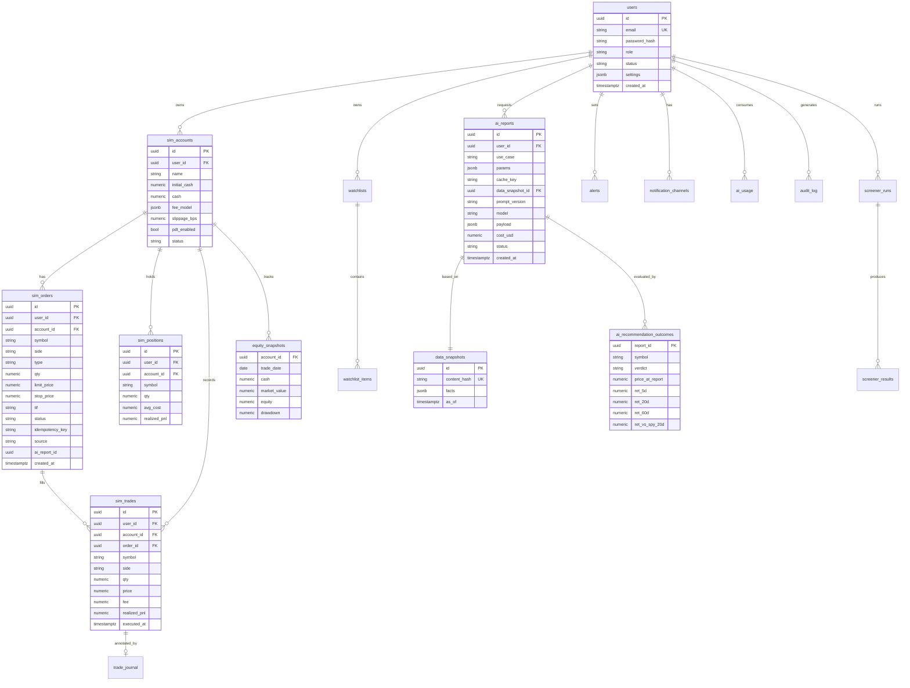

# 03 数据模型

## 1. 约定

- 主键：`UUID`（用户私有数据）或自然键（共享行情数据）。
- 金额/价格：`NUMERIC(18,6)`；数量：`NUMERIC(18,6)`（预留碎股）。
- 时间：`TIMESTAMPTZ`，UTC；交易日：`DATE`（美东交易日）。
- 所有用户私有表含 `user_id UUID NOT NULL`，并建索引；Repository 基类强制过滤。
- 软删除用 `deleted_at`；审计类表只增不改。
- **共享参考数据**（行情、财报快照）无 `user_id`，所有用户只读共享，节省数据源调用。

## 2. ER 图

## 3. 表清单

### 3.1 用户与安全（M1 identity，字段与约束见 `docs/tasks/M1/CONTRACTS.md §3`）
| 表 | 关键字段 | 说明 |
|---|---|---|
| `users` | id(UUID PK), email(唯一), password_hash(argon2), role, status, settings(JSONB), created_at/updated_at | settings 存风险偏好、语言、默认账户；email 规范化为小写 |
| `refresh_tokens` | id, user_id(FK `users` CASCADE), token_hash(SHA-256，唯一), expires_at, revoked_at, created_at/updated_at | 刷新令牌；只存摘要，`revoked_at` 保证即时吊销 |
| `password_reset_tokens` | id, user_id(FK `users` CASCADE), token_hash(SHA-256，唯一), expires_at, used_at, created_at/updated_at | 密码重置一次性令牌（M1 裁定 C3），只存摘要 |
| `audit_log` | user_id(FK `users` SET NULL), action, entity, entity_id, ip, detail, created_at | 只增不改；M0 迁移未加外键，由 M1 的 `0003_identity`（接在 M2 `0002_marketdata` 之后）补上并清理历史孤儿行 |
| `ai_usage` | id, user_id(FK `users` CASCADE), usage_date, calls, tokens_in, tokens_out, cost_usd(Numeric 18,6), created_at/updated_at | 配额与成本统计，按 `(user_id, usage_date)` 唯一；**M1 只读**，写入与扣减属 M5（裁定 C6） |

### 3.2 共享行情与快照（无 user_id）
| 表 | 主键/索引 | 说明 |
|---|---|---|
| `symbols` | symbol | 代码、名称、交易所、行业、状态 |
| `bars_daily` | (symbol, trade_date) | OHLCV + adj_close，按年分区（后期） |
| `corporate_actions` | (symbol, ex_date, type) | 拆股、分红 |
| `fundamentals_snapshots` | (symbol, as_of) | 估值、盈利指标快照 |
| `financial_statements` | (symbol, period_end, period_type) | 三表，JSONB |
| `earnings_events` | (symbol, report_date) | 预期 vs 实际、指引、财报后涨跌 |
| `news_items` | id, symbol, published_at | 标题、摘要、来源、链接（遵守源站条款） |
| `data_snapshots` | content_hash | AI 输入事实的快照，**可复盘的关键** |
| `market_calendar` | trade_date | 开收盘时间、是否半日市 |

### 3.3 模拟盘（用户私有）
| 表 | 说明 |
|---|---|
| `sim_accounts` | 每用户可多账户；手续费模型、滑点、是否启用 PDT |
| `sim_orders` | 唯一约束 `(account_id, idempotency_key)` 防重复提交 |
| `sim_trades` | 成交记录，含手续费与已实现盈亏 |
| `sim_positions` | 平均成本法；`(account_id, symbol)` 唯一 |
| `equity_snapshots` | 每日净值快照，用于曲线与回撤 |
| `trade_journal` | 交易理由、情绪标签、事后复盘备注 |

### 3.4 AI、筛选、自选（用户私有）
| 表 | 说明 |
|---|---|
| `ai_reports` | 每份 AI 输出；`cache_key` 索引；记录提示词版本、模型、成本 |
| `ai_recommendation_outcomes` | 定时任务回填 5/20/60 日后表现及相对 SPY 超额 |
| `watchlists` / `watchlist_items` | 用户自选清单（含主题标签） |
| `screener_runs` / `screener_results` | 筛选任务与结果（策略 id、参数、股票池、结果排名） |
| `alerts` | 价格/信号/财报日提醒规则与触发状态 |
| `notification_channels` | 用户通知渠道配置（密钥加密存储） |
| `tasks` | 异步任务状态：queued/running/succeeded/failed，结果引用 |

## 4. 关键规则

1. **平均成本法**计算持仓成本与已实现盈亏（v1）；FIFO 批次表留作后续扩展。
2. **净值恒等式**：`equity = cash + Σ(qty × 最新价)`；卖出收入入 cash；手续费实时扣减。违反即为缺陷（见测试计划不变量）。
3. **AI 报告不可变**：创建后只允许增加评价结果，不允许修改 payload。
4. **数据快照去重**：同样 facts 的哈希相同则复用同一快照。
5. **拆股处理**：行情用复权价；持仓在除权日按比例调整数量与成本（由 corporate_actions 驱动，幂等）。
6. **多租户**：任何查询用户私有表必须带 `user_id`；仓库层单元测试验证"用户 A 无法读取/修改用户 B 的数据"。
7. **数据保留**：`bars_daily` 长期保留；`news_items` 保留 12 个月；`ai_reports` 与审计日志长期保留。
