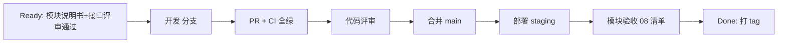

# 07 交付标准

## 1. 开发流程

### 1.1 Definition of Ready（开始开发前）
- 模块说明书（04）已评审，接口签名与错误码已确定；
- 涉及 API 的，已更新 05 文档；涉及表的，已更新 03 文档；涉及 AI 的，已更新 06 文档；
- 验收清单（08）已列出；
- 依赖模块已 Done。

### 1.2 Definition of Done（模块完成）

全部满足才算完成：

| # | 标准 | 如何验证 |
|---|---|---|
| 1 | 接口与文档一致 | OpenAPI 与 05 文档对照；文档更新随 PR |
| 2 | 类型检查通过 | `mypy --strict` 对模块无错误 |
| 3 | 代码风格 | `ruff check` + `ruff format --check` 无告警 |
| 4 | 架构边界 | `import-linter` 通过（无跨模块越界引用） |
| 5 | 测试 | 单元+契约+集成通过；模块核心逻辑覆盖率 ≥ 80%；金融计算类 ≥ 95% |
| 6 | 多租户 | 越权测试覆盖该模块所有私有端点 |
| 7 | 可观测 | 关键路径有结构化日志与指标；外部调用有超时、重试 |
| 8 | 迁移 | Alembic 迁移可升可降；在空库与带数据库上均通过 |
| 9 | 安全 | 无硬编码密钥；依赖扫描无高危漏洞 |
| 10 | 验收 | 08 中该模块清单全部勾选，并留存验收记录 |
| 11 | 变更记录 | CHANGELOG 更新；必要时新增 ADR |
| 12 | 可演示 | 提供演示脚本或页面，非作者可运行 |

## 2. Git 规范

- 主干：`main`（始终可部署）；开发：`feat/<module>-<topic>`、`fix/...`；
- 提交信息：Conventional Commits（`feat(simbroker): ...`、`fix(marketdata): ...`）；
- PR 要求：描述变更、关联模块与文档、测试证据、迁移说明；一个 PR 只做一件事，**不跨模块大改**；
- 合并策略：squash merge；`main` 受保护，必须 CI 通过。

## 3. CI/CD

| 阶段 | 内容 |
|---|---|
| 静态检查 | ruff、mypy、import-linter、前端 eslint/tsc |
| 测试 | pytest（单元/契约/集成，使用 Postgres+Redis 服务容器）、前端单测 |
| 安全 | 依赖漏洞扫描（pip-audit / npm audit）、密钥扫描 |
| 构建 | 构建 Docker 镜像，打 tag |
| 部署 | staging 自动部署；production 手动批准；部署后冒烟测试（`/readyz` + E2E-01） |
| 回滚 | 保留上一个镜像；迁移向前兼容，必要时先回滚代码再处理数据 |

## 4. 环境

| 环境 | 用途 | 数据源 | LLM |
|---|---|---|---|
| local | 开发 | fixture/yfinance | Mock 为主 |
| ci | 自动化测试 | 录制 fixture | Mock |
| staging | 验收 | 真实数据源 | 真实（低配额） |
| production | 线上 | 授权数据源 | 真实 |

配置通过环境变量注入；`deploy/env.example` 列出全部变量及说明；密钥使用云厂商密钥管理或 Docker secrets，不入库不入仓。

## 5. 代码规范要点

- Python 3.12+，全面类型标注，公开函数写 docstring（含单位与时区说明）；
- 金额一律 `Decimal`，禁止 `float` 参与资金计算；
- 时间一律带时区；业务日历逻辑只调用 `core.calendar`；
- 路由层不写业务逻辑；service 层函数不依赖 HTTP 对象；
- 外部调用必须经端口；禁止在业务代码中直接 `import yfinance` 或 `import anthropic`；
- 异常使用统一 `AppError` 子类，不裸抛底层异常到 API 层；
- 日志不得包含密码、令牌、API Key。

## 6. 安全基线（开放给他人前必须全部满足）

| 类别 | 要求 |
|---|---|
| 传输 | 全站 HTTPS，HSTS；内部服务不暴露公网（仅 Nginx 对外） |
| 认证 | 密码 argon2；登录限流；刷新令牌可吊销；管理员建议加二步验证 |
| 授权 | 所有私有资源按 `user_id` 校验；越权返回 404 |
| 输入 | 全部经 Pydantic 校验；SQL 仅用参数化（ORM）；输出转义 |
| 浏览器 | CORS 白名单、安全响应头（CSP 等）、Cookie 若使用则 `HttpOnly+Secure+SameSite` |
| 密钥 | 外部 API Key 仅存服务端；用户配置的通知密钥加密存储 |
| 滥用防护 | 按用户/IP 限流；AI 每日配额；全局预算熔断；注册验证邮箱 |
| 审计 | 登录、下单、配置变更、管理员操作留痕 |
| 备份 | Postgres 每日备份，保留 ≥ 14 天，每季度做一次恢复演练 |
| 依赖 | 锁定版本，定期扫描漏洞并升级 |
| 隐私 | 最小化收集；提供账号与数据删除；日志脱敏 |

## 7. 合规与产品声明

- 所有 AI 输出与相关页面显示固定免责声明（`not_investment_advice_v1`）；
- 明确系统为**研究与模拟用途**，模拟盘结果不代表真实交易结果（无真实滑点、流动性、情绪因素）；
- 行情数据遵守数据供应商条款；开放前必须使用有再分发授权的数据源；
- 是否构成需持牌的投资建议业务，取决于你所在地区法规，**上线前请咨询当地专业人士**。

## 8. 版本与发布

- 语义化版本 `vMAJOR.MINOR.PATCH`；每个模块 Done 合并后打里程碑 tag（如 `m4-simbroker-v0.1.0`）；
- CHANGELOG 按模块分类；
- 破坏性 API 变更须在文档中标注并升版本。

## 9. 运行与支持（Runbook 要点）

- 监控：错误率、P95 延迟、队列长度、数据源失败率、AI 成本；
- 告警：数据源连续失败、AI 失败率飙升、预算 80%、收盘任务未完成；
- 常见故障手册放 `docs/runbook.md`（M10 交付）：数据源切换、重跑收盘任务、熔断恢复、数据库恢复。
