# StockPilot 设计文档集

> 项目代号 `StockPilot`（占位名，可替换）。美股个人/多用户 AI 辅助投资研究与模拟交易系统。

## 文档地图

| 文档 | 内容 | 读者 |
|---|---|---|
| [01-prd.md](01-prd.md) | 需求、用户故事、范围与非目标 | 全员 |
| [02-architecture.md](02-architecture.md) | 架构原则、C4 图、五大端口接口、目录结构、横切关注点 | 开发 |
| [03-data-model.md](03-data-model.md) | ER 图、表结构、多租户规则 | 开发 |
| [04-modules.md](04-modules.md) | M0–M10 各模块说明书（统一模板） | 开发 |
| [05-api-spec.md](05-api-spec.md) | API 约定、端点清单、错误码、异步任务模式 | 前后端 |
| [06-ai-prompt-spec.md](06-ai-prompt-spec.md) | AI 调用规范、输出 Schema、防编造机制 | 开发/AI |
| [07-delivery-standard.md](07-delivery-standard.md) | 交付标准、DoD、Git/CI、环境、安全基线 | 全员 |
| [08-test-plan.md](08-test-plan.md) | 测试策略、验收清单（每模块） | 开发/验收 |
| [09-adr.md](09-adr.md) | 架构决策记录 | 开发 |

## 已确认的前提

| 决策点 | 结论 | 影响 |
|---|---|---|
| 使用范围 | 将来可能开放给更多人 | 从第一天起做用户体系、多租户隔离、AI 配额、审计日志 |
| 部署 | 云服务器 + Docker | Docker Compose、Nginx + HTTPS、环境变量管理密钥、健康检查 |
| 文档形式 | Markdown，放进代码仓库 | 文档与代码同仓、Mermaid 画图、PR 里一起评审 |
| 市场 | 美股 | 美东时区、NYSE 交易日历、夏令时、PDT、拆股分红 |

## 开发路线（按模块，每个模块独立验收后再进入下一个）

```mermaid
gantt
    title 模块开发顺序（周为粗略估计）
    dateFormat  X
    axisFormat  W%s
    section 地基
    M0 骨架/配置/部署        :m0, 0, 1
    M1 用户与多租户          :m1, after m0, 1
    M2 数据服务              :m2, after m0, 1
    M3 指标与策略引擎        :m3, after m2, 1
    M4 模拟盘引擎            :m4, after m2, 1
    M5 AI 核心框架           :m5, after m0, 1
    section AI 用例
    M6 研究/买入决策/财报     :m6, after m5, 1
    M7 对比/长期/组合         :m7, after m6, 1
    section 产品化
    M8 筛选器与主题自选       :m8, after m3, 1
    M9 Web 前端              :m9, after m4, 2
    M10 调度/提醒/复盘/运维   :m10, after m9, 1
```

**路线图状态**（单一可勾选状态行，归协调者维护；T11 合并后把 M0 置为 ✅）：

| 模块 | 状态 | 更新依据 |
|---|---|---|
| M0 地基 | ✅ Done | 2026-11-12 T11 归档 `docs/acceptance/M0.md` + tag `m0-foundation-v0.1.0` |
| M1 用户与多租户 | ✅ Done | 2026-11-12 T07 归档 `docs/acceptance/M1.md` + tag `m1-identity-v0.2.0` |
| M2 数据服务 | ✅ Done | 2026-11-12 T07 归档 `docs/acceptance/M2.md` + tag `m2-marketdata-v0.2.0` |
| M3 指标与策略引擎 | ✅ Done | 2026-11-13 T07 归档 `docs/acceptance/M3.md` + tag `m3-strategy-v0.3.0` |
| M4 模拟盘引擎 | ✅ Done | 2026-11-13 T08 归档 `docs/acceptance/M4.md` + tag `m4-simbroker-v0.4.0` |
| M5 AI 核心框架 | ✅ Done | 2026-11-14 T08 归档 `docs/acceptance/M5.md` + tag `m5-ai-v0.5.0` |
| M6 投研分析与买入决策 | ✅ Done | 2026-11-15 T08 归档 `docs/acceptance/M6.md` + tag `m6-research-v0.6.0` |
| M7 对比/长期/组合 | ✅ Done | 2026-11-15 T08 归档 `docs/acceptance/M7.md` + tag `m7-comparison-portfolio-v0.7.0` |
| M8 筛选器与主题自选 | ✅ Done | 2026-11-15 T08 归档 `docs/acceptance/M8.md` + tag `v0.8.0` |
| M9 Web 前端 | ✅ Done | 2026-11-15 T08 归档 `docs/acceptance/M9.md` + tag `v0.9.0` |
| M10 调度/提醒/复盘/运维 | ☐ Todo | 各模块验收记录 `docs/acceptance/<module>.md` |

**原则**：M0–M5 是地基，质量不达标不进入 M6+。M6–M8 本质是"新增一个提示词/策略 + 一个接口"，扩展成本低。

## 开放前必须完成的事（上线门槛）

1. **数据源授权**：yfinance 是非官方接口，条款仅限个人使用。开放给他人前必须换成有再分发授权的数据源（Polygon / Tiingo / Alpaca 等），这是 `DataProvider` 端口存在的主要原因之一。
2. **合规声明**：所有 AI 输出带"非投资建议"，用户协议明确系统仅为研究与模拟用途。是否涉及投资顾问相关监管，需按你所在地区咨询专业人士。
3. **安全基线**：见 [07-delivery-standard.md](07-delivery-standard.md) 第 6 节。
4. **成本控制**：每用户 AI 日配额与全局熔断。
