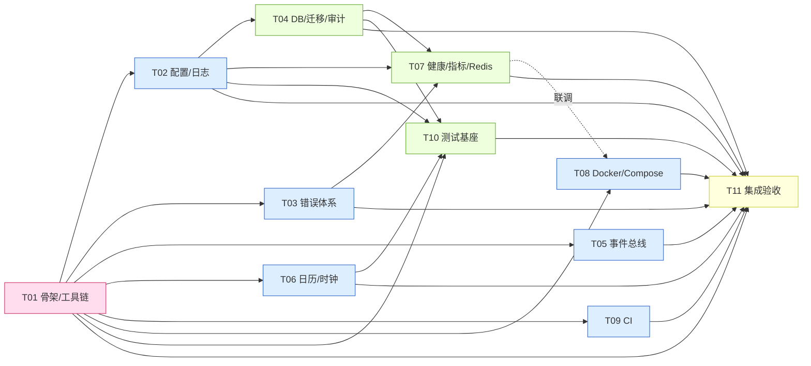

# M0 任务总览与调度

> 协调者：Claude（统筹）｜执行：其他 AI Agent｜验收：协调者 + 你

M0 目标与验收见 [`docs/04-modules.md`](../../04-modules.md)（M0 一节）与 [`docs/08-test-plan.md`](../../08-test-plan.md)。
**所有 Agent 必读**：[AGENTS.md](../../../AGENTS.md) → [CONTRACTS.md](CONTRACTS.md) → 自己的任务卡。

## 任务清单

| ID | 任务 | 波次 | 依赖 | 规模 | 负责 Agent | 状态 |
|---|---|---|---|---|---|---|
| [T01](T01-skeleton-toolchain.md) | 仓库骨架与工具链 | 0 | — | 小 | _未分配_ | Todo |
| [T02](T02-config-logging.md) | 配置、日志、请求上下文 | 1 | T01 | 中 | _未分配_ | Todo |
| [T03](T03-errors.md) | 统一错误体系 | 1 | T01 | 小–中 | _未分配_ | Todo |
| [T05](T05-event-bus.md) | 事件总线与领域事件 | 1 | T01 | 小 | _未分配_ | Todo |
| [T06](T06-calendar-clock.md) | NYSE 日历与时钟 | 1 | T01 | 中 | _未分配_ | Todo |
| [T08](T08-docker-compose-worker.md) | Docker / Compose / Nginx / Worker | 1→2 | T01（联调需 T02、T04、T07） | 大 | _未分配_ | Todo |
| [T09](T09-ci-pipeline.md) | CI 流水线 | 1 | T01 | 中 | _未分配_ | Todo |
| [T04](T04-database-alembic-audit.md) | 数据库 / 迁移 / 审计表 | 2 | T01、T02 | 中–大 | _未分配_ | Todo |
| [T07](T07-health-metrics-redis.md) | Redis / 健康检查 / 指标 / 生命周期 | 2 | T02、T03、T04 | 中 | _未分配_ | Todo |
| [T10](T10-test-infrastructure.md) | 测试基础设施 | 2 | T01、T02、T04、T06 | 中 | _未分配_ | Todo |
| [T11](T11-integration-acceptance.md) | 集成验收与收尾 | 3 | T01–T10 | 中 | _未分配_ | Todo |

## 依赖图

## 并行策略

| 波次 | 可同时进行的任务 | 最多并行 Agent 数 |
|---|---|---|
| Wave 0 | T01 | 1 |
| Wave 1 | T02、T03、T05、T06、T09、T08（Dockerfile/Compose 部分） | 6 |
| Wave 2 | T04（等 T02）、T07（等 T02+T03+T04）、T10（等 T04+T06）、T08 联调收尾 | 3–4 |
| Wave 3 | T11 | 1 |

**关键路径**：T01 → T02 → T04 → T07 → T11（其余任务不在关键路径上）。建议把最稳的 Agent 分给关键路径任务。

## 文件所有权矩阵（防冲突）

| 文件/目录 | 所有者 | 其他任务 |
|---|---|---|
| `backend/pyproject.toml` | T01 | T10 仅限 `[tool.coverage]`/`[tool.pytest.ini_options]` |
| `backend/app/main.py` | T01 | 仅 T11 可做接缝修复 |
| `core/config.py` `core/logging.py` | T02 | — |
| `core/middleware.py` | T02 | T07 仅限"指标插入点"一行 |
| `core/errors.py` | T03 | — |
| `core/db.py` `core/audit.py` `alembic/**` | T04 | — |
| `core/events.py` `domain/events.py` | T05 | — |
| `core/calendar.py` `core/clock.py` | T06 | — |
| `core/redis.py` `core/metrics.py` `core/lifecycle.py` `api/health.py` `api/router.py` | T07 | — |
| `deploy/**` `app/worker.py` | T08 | — |
| `.github/workflows/**` `dependabot.yml` `CODEOWNERS` `docs/ci.md` | T09 | — |
| `tests/conftest.py` `tests/fixtures/**` `docs/testing-guide.md` | T10 | T04 的三个测试文件可由 T10 做 fixture 替换 |
| `docs/acceptance/M0.md` | T11 | — |
| `docs/01`–`09`、`AGENTS.md`、`.github/PULL_REQUEST_TEMPLATE.md` | 协调者 | 任何人不得改 |

## 协调规则

1. **合并顺序**：严格按依赖；Wave 1 任务可任意顺序合并，但都必须在 T01 之后。
2. **冲突处理**：出现文件冲突说明有人越权修改——以所有权矩阵为准，由协调者裁决。
3. **契约变更**：提 Issue → 协调者评估 → 更新 `CONTRACTS.md` 并通知所有受影响任务（在相关 Issue 评论 @）。
4. **评审**：每个 PR 由协调者逐条对照任务卡验收标准评审；证据不全一律退回。
5. **阻塞上报**：任何 Agent 阻塞超过 30 分钟，在 Issue 评论说明阻塞点与已尝试方案。
6. **状态更新**：Agent 在 Issue 里更新状态；协调者在合并后更新本表。

## 给你（项目负责人）的分配建议

- **不同模型各取所长**：T01、T04、T07（关键路径，需要严谨）给最强的 Agent；T05、T03、T06（边界清晰、测试驱动）适合中等 Agent；T08、T09（偏运维配置）给熟悉 Docker/CI 的 Agent；T11 给独立的 QA Agent。
- **给每个 Agent 的开场指令**（复制即可）：
  > 你负责仓库 `sysplex/AI-repository` 的任务 **M0-Txx**。请先完整阅读 `AGENTS.md`、`docs/tasks/M0/README.md`、`docs/tasks/M0/CONTRACTS.md` 和 `docs/tasks/M0/Txx-*.md`，严格遵守文件所有权与接口契约。依赖任务未合并前不要开工。完成后按 PR 模板汇报，逐条给出验收证据。有疑问在对应 Issue 里评论，不要自行修改契约。
- 同一个 Agent 不要同时做有依赖关系的相邻任务以外的"顺手改动"。
