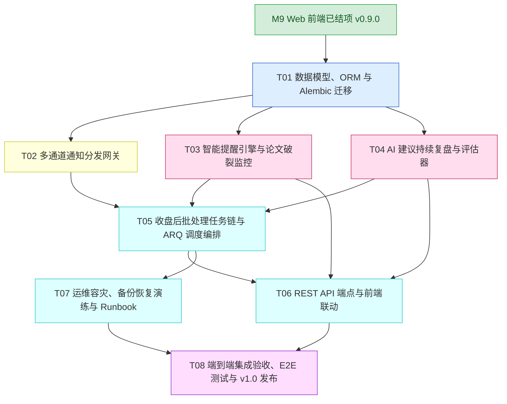

# M10 调度、提醒、日报、复盘与运维（Scheduler & Notify & Ops）任务总览与调度

> 协调者：Antigravity（统筹）｜执行：执行 Agent｜验收：协调者 + 用户  
> 对应设计：[`docs/01-prd.md§4 (F12, F13)`](../../01-prd.md)｜[`docs/04-modules.md#m10`](../../04-modules.md)｜[`docs/02-architecture.md`](../../02-architecture.md)｜[`docs/03-data-model.md§3.4`](../../03-data-model.md)｜[`docs/05-api-spec.md§2.7-2.9`](../../05-api-spec.md)｜[`docs/08-test-plan.md§5 M10`](../../08-test-plan.md)

**所有 Agent 必读**：[AGENTS.md](../../../AGENTS.md) → [CONTRACTS.md](CONTRACTS.md) → 自己的任务卡。

---

## 1. 任务清单

| ID | Issue | 任务名称 | 建议分支 | 依赖 | 规模 | 负责 Agent | 状态 |
|---|---|---|---|---|---|---|---|
| [T01](T01-domain-models-orm-and-migration.md) | #181 | 数据模型、ORM 实体与数据库迁移（Alerts, Channels, History, Daily Reports） | `feat/m10-t01-models-and-migrations` | M9 已结项 | 中 | Antigravity | ✅ 已完成 (Commit f317438) |
| [T02](T02-notification-dispatcher.md) | #182 | 多通道通知分发网关与告警调度器（Email, Webhook, In-App Dispatcher） | `feat/m10-t02-notification-dispatcher` | T01 | 中 | Antigravity | ✅ 已完成 (Commit ce918ae) |
| [T03](T03-alert-and-thesis-breaker-engine.md) | #183 | 智能提醒引擎与长期持有论文破裂监控（Alert Engine & Thesis Breakers） | `feat/m10-t03-alert-and-thesis-breaker-engine` | T01, T02 | 中–大 | Antigravity | ✅ 已完成 (Commit 717d308) |
| [T04](T04-ai-recommendation-evaluator.md) | #184 | AI 投资建议持续复盘与超额收益评估器（AI Recommendation Outcomes Evaluator） | `feat/m10-t04-ai-recommendation-evaluator` | T01 | 中 | Antigravity | ✅ 已完成 (Commit b893e26) |
| T05 | #185 | 收盘后全流程自动化批处理工作流与 ARQ 调度编排（Post-Market DAG Pipeline） | `feat/m10-t05-post-market-scheduler-pipeline` | T02, T03, T04 | 大 | Antigravity | ⏳ 待开始 |
| T06 | #186 | REST API 端点开放与前端提醒及复盘看板联动（API & UI Integration） | `feat/m10-t06-api-and-ui-integration` | T03, T04, T05 | 中–大 | Antigravity | ⏳ 待开始 |
| T07 | #187 | 运维容灾、监控告警体系与故障应急手册（Prometheus, Backup & Runbook） | `feat/m10-t07-ops-backup-runbook` | T05 | 中 | Antigravity | ⏳ 待开始 |
| T08 | #188 | 全链路端到端集成验收、自动化测试体系与 v1.0 结项发布（E2E Acceptance & Closeout） | `feat/m10-t08-m10-acceptance-and-closeout` | T01–T07 | 中 | Antigravity | ⏳ 待开始 |

---

## 2. 依赖图

---

## 3. 质量门禁与定义完成（DoD）

1. **时区与夏冬令时**：所有调度逻辑必须严格使用 `America/New_York`，夏冬令时切换日与半日市调度正确。
2. **幂等性保障**：收盘批处理任务链重复执行结果必须完全一致，绝不重复生成订单、脏净值或重复发送告警通知。
3. **通知静默降级**：外部通知网络失败绝不阻断核心撮合、估值与数据同步流程，并提供错误日志与重试机制。
4. **论文破裂可监控**：M7 输出的 `thesis_breakers` 能够准确匹配为量化规则并可触发提醒。
5. **AI 复盘准确性**：回填 5/20/60 日绝对收益与相对 SPY 超额收益计算严密，无未来函数。
6. **代码测试覆盖率**：后端整体单元测试保持 ≥ 80%，关键业务逻辑覆盖率 ≥ 90%。
