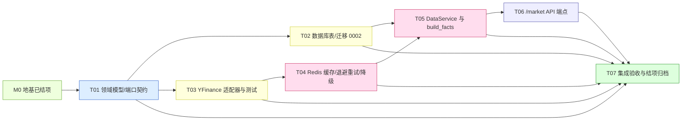

# M2 数据服务（marketdata）任务总览与调度

> 协调者：Antigravity（统筹）｜执行：执行 Agent｜验收：协调者 + 用户
> 对应设计：[`docs/04-modules.md#m2`](../../04-modules.md)｜[`docs/02-architecture.md§3`](../../02-architecture.md)｜[`docs/03-data-model.md§3.2`](../../03-data-model.md)｜[`docs/05-api-spec.md§2.2`](../../05-api-spec.md)｜[`docs/08-test-plan.md§5`](../../08-test-plan.md)

**所有 Agent 必读**：[AGENTS.md](../../../AGENTS.md) → [CONTRACTS.md](CONTRACTS.md) → 自己的任务卡。

## 1. 任务清单

| ID | 任务 | 建议分支 | 依赖 | 规模 | 负责 Agent | 状态 |
|---|---|---|---|---|---|---|
| [T01](T01-domain-models-and-ports.md) | 领域数据模型、类型与 DataProvider 端口契约 | `feat/m2-t01-models-ports` | M0 已结项 | 小–中 | _未分配_ | Todo |
| [T02](T02-database-schema-migrations.md) | M2 共享行情表结构与 Alembic 迁移（0002） | `feat/m2-t02-db-tables` | T01 | 中 | _未分配_ | Todo |
| [T03](T03-yfinance-adapter.md) | YFinance 数据源适配器、离线 Fixture 与契约测试 | `feat/m2-t03-yfinance-adapter` | T01 | 中–大 | _未分配_ | Todo |
| [T04](T04-cache-and-resilience.md) | Redis 缓存代理、指数退避重试与降级（stale） | `feat/m2-t04-cache-resilience` | T01、T03 | 中 | _未分配_ | Todo |
| [T05](T05-data-service-and-facts.md) | DataService 核心编排服务与 AI 事实快照（build_facts） | `feat/m2-t05-data-service-facts` | T01、T02、T03、T04 | 中–大 | _未分配_ | Todo |
| [T06](T06-api-endpoints.md) | `/market/*` REST API 端点与路由接入 | `feat/m2-t06-api-endpoints` | T05 | 中 | _未分配_ | Todo |
| [T07](T07-integration-and-acceptance.md) | 集成验收、拆股/复权验证与 M2 结项文档 | `feat/m2-t07-integration-acceptance` | T01–T06 | 中 | _未分配_ | Todo |

## 2. 依赖图



## 3. 执行策略

延续 M0 经验证行之有效的**严格线性顺序推进**：
```
T01 → T02 → T03 → T04 → T05 → T06 → T07
```
- 一任务一分支一 PR，前一个 PR 合并并自测全绿后才开启下一分支。
- 所有金额/价格均采用 `Decimal`；时间使用 UTC `datetime`；交易日为 `date`（美东交易日日历）。
- 外部 SDK（`yfinance`）仅能出现在 `app/modules/marketdata/adapters/` 内部。

## 4. 文件所有权矩阵

| 文件/目录 | 所有者 | 其他任务权限 |
|---|---|---|
| `backend/app/modules/marketdata/models.py` | T01 | 只读 |
| `backend/app/modules/marketdata/ports.py` | T01 | 只读（契约以 CONTRACTS.md 为准） |
| `backend/app/modules/marketdata/tables.py` | T02 | 只读 |
| `backend/alembic/versions/0002_marketdata.py` | T02 | — |
| `backend/app/modules/marketdata/adapters/**` | T03 | — |
| `backend/tests/fixtures/m2/**` | T03 | T07 可补充验收样例 |
| `backend/app/modules/marketdata/cache.py` | T04 | — |
| `backend/app/modules/marketdata/service.py` | T05 | — |
| `backend/app/modules/marketdata/api.py` | T06 | — |
| `backend/app/api/router.py` | T06 | 仅注册 marketdata router |
| `backend/pyproject.toml` | T03（引入 yfinance 及 per-file-ignores） | 其他任务不得修改 |
| `docs/acceptance/M2.md` | T07 | — |
| `docs/tasks/M2/**` | 协调者 | 任何人不得擅自改动契约 |

## 5. 验收标准基线（DoD）

1. `make check`（ruff + mypy --strict + import-linter + pytest）全部通过。
2. 契约测试：`DataProvider` 协议针对实现完全通用，离线回放 fixture 不依赖真实外网。
3. 缓存测试：命中缓存时不产生外部网络调用（断言调用计数为 0）。
4. 容灾降级：外部超时/限流退避重试失败后，回退缓存并标注 `stale=true`；无缓存抛 `DATA_UNAVAILABLE`，**严禁返回推测伪造数据**。
5. 事实快照：`build_facts` 输出内容规范且计算一致性哈希，缺失字段显式标 `null` 并进入 `missing_fields` 清单。
6. 公司行动与复权：NVDA 2024-06 拆股（10:1）等案例测试计算正确。
