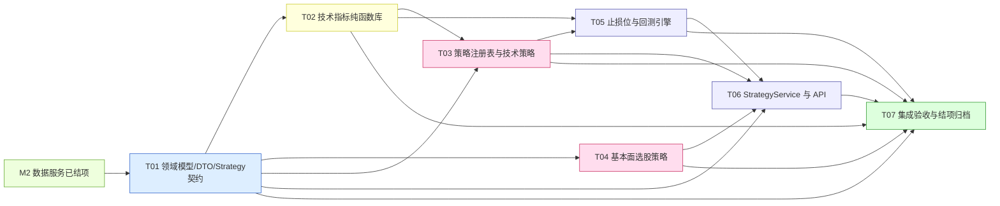

# M3 指标与策略引擎（strategy）任务总览与调度

> 协调者：Antigravity（统筹）｜执行：执行 Agent｜验收：协调者 + 用户
> 对应设计：[`docs/04-modules.md#m3`](../../04-modules.md)｜[`docs/02-architecture.md§5`](../../02-architecture.md)｜[`docs/05-api-spec.md§2.3`](../../05-api-spec.md)｜[`docs/08-test-plan.md§5`](../../08-test-plan.md)

**所有 Agent 必读**：[AGENTS.md](../../../AGENTS.md) → [CONTRACTS.md](CONTRACTS.md) → 自己的任务卡。

---

## 1. 任务清单

| ID | Issue | 任务名称 | 建议分支 | 依赖 | 规模 | 负责 Agent | 状态 |
|---|---|---|---|---|---|---|---|
| [T01](T01-domain-models-and-ports.md) | #71 | 领域数据模型、DTO Schema 与 Strategy 协议契约 | `feat/m3-t01-models-ports` | M2 已结项 | 小–中 | Antigravity | Todo |
| [T02](T02-technical-indicators.md) | #72 | 纯数学技术指标库实现与高精度参考对齐 | `feat/m3-t02-indicators` | T01 | 中 | _待认领_ | Todo |
| [T03](T03-technical-strategies.md) | #73 | 策略引擎注册表与 v1 技术面策略（海龟/道氏/RSI回调/123反转） | `feat/m3-t03-technical-strategies` | T01、T02 | 中–大 | _待认领_ | Todo |
| [T04](T04-fundamental-strategies.md) | #74 | 基本面与量化选股策略（价值/成长/红利） | `feat/m3-t04-fundamental-strategies` | T01 | 中 | _待认领_ | Todo |
| [T05](T05-levels-and-backtest.md) | #75 | 动态止损/目标位计算与轻量事件驱动回测引擎 | `feat/m3-t05-levels-and-backtest` | T02、T03 | 中–大 | _待认领_ | Todo |
| [T06](T06-strategy-service-and-api.md) | #76 | StrategyService 门面服务与 /strategy/* REST API 路由接入 | `feat/m3-t06-service-and-api` | T01–T05 | 中 | _待认领_ | Todo |
| [T07](T07-integration-and-acceptance.md) | #77 | 全链路集成验收、防未来函数全策略校验与 M3 结项报告 | `feat/m3-t07-integration-acceptance` | T01–T06 | 中 | _待认领_ | Todo |

---

## 2. 依赖图

---

## 3. 执行策略

延续 M0 / M1 / M2 验证成功的规范化流程：
1. **严格线性推进**：一个任务 = 一个分支 = 一个 PR。
2. **防未来函数铁律（Lookahead Bias 防护）**：
   - 所有的指标计算与策略评估，所使用的数据截止时间必须严格 `ts <= as_of`。
   - 必须通过截断测试：对任意 `as_of`，将 `as_of` 之后的历史数据替换或删除，计算出的指标与 `Signal` 必须完全相同。
3. **精度规范**：所有价格、点位、资金计算一律使用 `Decimal`，严禁使用 `float`。
4. **外部隔离**：`strategy` 模块只能通过 `marketdata.service.DataService` 获取行情与财报，严禁直接跨模块读表或引入 `yfinance` 等外部 SDK。

---

## 4. 文件所有权矩阵

| 文件/目录 | 所有者 | 其他任务权限 |
|---|---|---|
| `backend/app/modules/strategy/ports.py` | T01 | 只读（契约以 CONTRACTS.md 为准） |
| `backend/app/modules/strategy/schemas.py` | T01 | 只读 |
| `backend/app/modules/strategy/indicators.py` | T02 | 只读 |
| `backend/app/modules/strategy/registry.py` | T03 | 只读 |
| `backend/app/modules/strategy/strategies/` | T03, T04 | 各自实现子文件 |
| `backend/app/modules/strategy/levels.py` | T05 | 只读 |
| `backend/app/modules/strategy/backtest.py` | T05 | 只读 |
| `backend/app/modules/strategy/service.py` | T06 | — |
| `backend/app/modules/strategy/api.py` | T06 | — |
| `backend/app/api/router.py` | T06 | 仅挂载 strategy router |
| `backend/tests/fixtures/m3/**` | T02, T03 | T07 可补充验收样例 |
| `docs/acceptance/M3.md` | T07 | — |
| `docs/tasks/M3/**` | 协调者 | 任何人不得擅自改动契约 |

---

## 5. 验收标准基线（DoD）

1. `make check`（ruff + mypy --strict + import-linter + pytest）全部通过，全库覆盖率 ≥ 80%。
2. 指标精度：与 TA-Lib / 手算参考值误差 < 1e-6。
3. 防未来函数：全策略通过未来函数篡改测试。
4. 策略样例：每个策略至少包含 2 组"触发"与"不触发"真实样例。
5. 止损/目标位：ATR 动态止损/目标位与手算样例精确吻合。
6. 回测撮合：无未来函数步进撮合，资金、收益率与最大回撤计算准确。
