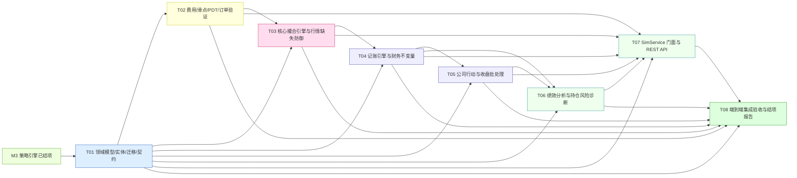

# M4 模拟盘引擎（simbroker）任务总览与调度

> 协调者：Antigravity（统筹）｜执行：执行 Agent｜验收：协调者 + 用户
> 对应设计：[`docs/04-modules.md#m4`](../../04-modules.md)｜[`docs/02-architecture.md§5`](../../02-architecture.md)｜[`docs/03-data-model.md§3.3`](../../03-data-model.md)｜[`docs/05-api-spec.md§2.4`](../../05-api-spec.md)｜[`docs/08-test-plan.md§6`](../../08-test-plan.md)

**所有 Agent 必读**：[AGENTS.md](../../../AGENTS.md) → [CONTRACTS.md](CONTRACTS.md) → 自己的任务卡。

---

## 1. 任务清单

| ID | Issue | 任务名称 | 建议分支 | 依赖 | 规模 | 负责 Agent | 状态 |
|---|---|---|---|---|---|---|---|
| [T01](T01-domain-models-and-ports.md) | #85 | 领域数据模型、SQLAlchemy 实体、Alembic 迁移（0004_simbroker）与 DTO Schema | `feat/m4-t01-models-schemas-migration` | M3 已结项 | 中 | Antigravity | ✅ Merged (PR #93) |
| [T02](T02-fee-slippage-pdt-validation.md) | #86 | 费用模型、滑点、PDT 规则与订单验证引擎 | `feat/m4-t02-validation-fee-pdt` | T01 | 中 | Antigravity | ✅ Merged (PR #94) |
| [T03](T03-matching-engine.md) | #87 | 撮合引擎（市价/限价/止损单规则、TIF 与行情缺失防御） | `feat/m4-t03-matching-engine` | T01、T02 | 中–大 | Antigravity | ✅ Merged (PR #95) |
| [T04](T04-accounting-and-positions.md) | #88 | 记账引擎、持仓管理、平均成本法与财务不变量 | `feat/m4-t04-accounting-and-positions` | T01、T03 | 中 | Antigravity | ✅ Merged (PR #96) |
| [T05](T05-corporate-actions-and-close.md) | #89 | 公司行动（拆股/分红）、收盘批处理与净值快照 | `feat/m4-t05-corporate-actions-and-close` | T01、T04 | 中 | Antigravity | ✅ Merged (PR #97) |
| [T06](T06-performance-and-risk.md) | #90 | 绩效分析、回撤胜率、SPY 跑赢对比与持仓风险体检诊断 | `feat/m4-t06-performance-and-risk` | T01、T04、T05 | 中 | Antigravity | ✅ Merged (PR #98) |
| [T07](T07-simservice-and-api.md) | #91 | SimService 门面服务、Broker 适配器与 /api/v1/sim/* REST API 路由 | `feat/m4-t07-simservice-and-api` | T01–T06 | 中–大 | Antigravity | ✅ Merged (PR #99) |
| [T08](T08-integration-and-acceptance.md) | #92 | 全链路端到端集成验收、不变量全矩阵校验与 M4 结项报告 | `feat/m4-t08-integration-acceptance` | T01–T07 | 中 | Antigravity | ✅ Completed (PR #100) |

---

## 2. 依赖图

---

## 3. 执行策略

延续 M0–M3 验证成功的规范化流程：
1. **一个任务 = 一个分支 = 一个 PR**：开发前从最新 `main` 切分支，完成后提交 PR 并自检全绿。
2. **严守财务不变量**：
   - 现金守恒：`cash == initial_cash + deposits - withdrawals + sum(sell_proceeds) - sum(buy_costs) - sum(fees)`
   - 净值恒等：`equity == cash + market_value`
   - 不超卖：持仓数量一律 `qty >= 0`。
3. **精度规范**：所有金额、点位、手续费、成本、盈亏与净值一律使用 `Decimal`，严禁使用 `float`。
4. **外部隔离与整洁架构**：
   - `simbroker` 模块不得直接依赖 `marketdata` 的具体实现或模型，必须通过结构化协议与组合根依赖注入解耦。
   - `import-linter` 的 5 项架构契约必须 100% 保持（5 kept, 0 broken）。
5. **HARD-01 安全鉴权**：所有 `/api/v1/sim/*` 端点必须通过 `Depends(current_user)` 鉴权。

---

## 4. 文件所有权矩阵

| 文件/目录 | 所有者 | 其他任务权限 |
|---|---|---|
| `backend/app/modules/simbroker/models.py` | T01 | 只读 |
| `backend/alembic/versions/0004_simbroker.py` | T01 | 只读 |
| `backend/app/modules/simbroker/schemas.py` | T01 | 只读 |
| `backend/app/modules/simbroker/ports.py` | T01 | 只读 |
| `backend/app/modules/simbroker/fee.py` | T02 | 只读 |
| `backend/app/modules/simbroker/pdt.py` | T02 | 只读 |
| `backend/app/modules/simbroker/validator.py` | T02 | 只读 |
| `backend/app/modules/simbroker/matcher.py` | T03 | 只读 |
| `backend/app/modules/simbroker/accounting.py` | T04 | 只读 |
| `backend/app/modules/simbroker/corporate_actions.py` | T05 | 只读 |
| `backend/app/modules/simbroker/market_close.py` | T05 | 只读 |
| `backend/app/modules/simbroker/performance.py` | T06 | 只读 |
| `backend/app/modules/simbroker/risk.py` | T06 | 只读 |
| `backend/app/modules/simbroker/service.py` | T07 | — |
| `backend/app/modules/simbroker/adapter.py` | T07 | — |
| `backend/app/modules/simbroker/api.py` | T07 | — |
| `backend/app/api/router.py` | T07 | 挂载 sim router |
| `docs/acceptance/M4.md` | T08 | — |
| `docs/tasks/M4/**` | 协调者 | 任何人不得擅自改动契约 |
