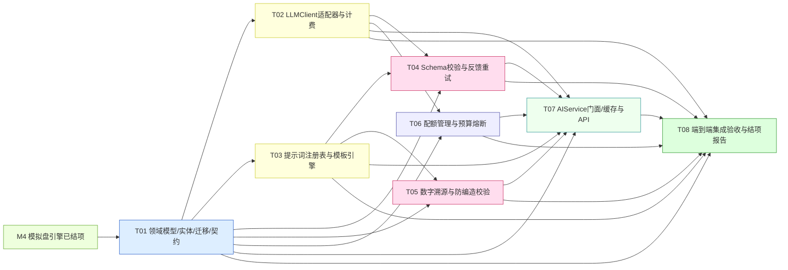

# M5 AI 核心框架（ai）任务总览与调度

> 协调者：Antigravity（统筹）｜执行：执行 Agent｜验收：协调者 + 用户
> 对应设计：[`docs/04-modules.md#m5`](../../04-modules.md)｜[`docs/02-architecture.md§5`](../../02-architecture.md)｜[`docs/03-data-model.md§3.4`](../../03-data-model.md)｜[`docs/05-api-spec.md§2.5`](../../05-api-spec.md)｜[`docs/08-test-plan.md§4.3, §5 M5`](../../08-test-plan.md)

**所有 Agent 必读**：[AGENTS.md](../../../AGENTS.md) → [CONTRACTS.md](CONTRACTS.md) → 自己的任务卡。

---

## 1. 任务清单

| ID | Issue | 任务名称 | 建议分支 | 依赖 | 规模 | 负责 Agent | 状态 |
|---|---|---|---|---|---|---|---|
| [T01](T01-domain-models-schemas-migration.md) | #101 | 领域数据模型、SQLAlchemy 实体、Alembic 迁移（0005_ai）与 DTO Schema | `feat/m5-t01-models-schemas-migration` | M4 已结项 | 中 | Antigravity | ✅ Merged (PR #109) |
| [T02](T02-llm-client-and-pricing.md) | #102 | LLMClient 适配器抽象、Mock 实现与高精 Token 计费器 | `feat/m5-t02-llm-client-pricing` | T01 | 中 | Antigravity | ✅ Merged (PR #110) |
| [T03](T03-prompt-registry-and-templates.md) | #103 | 提示词仓库注册表、版本管理与防提示注入模板引擎 | `feat/m5-t03-prompt-registry` | T01 | 中 | Antigravity | ✅ Merged (PR #111) |
| [T04](T04-schema-validation-and-retry.md) | #104 | 输出 Schema 校验器、JSON 清洗与单次自动重试包装 | `feat/m5-t04-schema-validation-retry` | T01, T02, T03 | 中 | Antigravity | ✅ Merged (PR #112) |
| [T05](T05-fact-tracing-and-hallucination-defense.md) | #105 | 数字溯源校验引擎与 AI 输出防编造防御（docs/08 §4.3） | `feat/m5-t05-fact-tracing-defense` | T01, T03 | 中 | Antigravity | ✅ Merged (PR #113) |
| [T06](T06-quota-and-budget-circuit-breaker.md) | #106 | 配额管理服务、成本追踪统计与预算熔断器 | `feat/m5-t06-quota-budget-breaker` | T01, T02 | 中 | Antigravity | Todo |
| [T07](T07-aiservice-cache-and-api.md) | #107 | AIService 核心编排门面、智能快照缓存与 `/api/v1/ai/*` REST API | `feat/m5-t07-aiservice-cache-api` | T01–T06 | 中–大 | Antigravity | Todo |
| [T08](T08-integration-and-acceptance.md) | #108 | 全链路端到端集成验收、防编造压力拦截与 M5 结项报告 | `feat/m5-t08-integration-acceptance` | T01–T07 | 中 | Antigravity | Todo |

---

## 2. 依赖图

---

## 3. 执行策略

延续 M0–M4 验证成功的规范化流水线：
1. **一个任务 = 一个分支 = 一个 PR**：开发前从最新 `main` 切分支，完成后提交 PR 并自检全绿。
2. **严守防编造铁律（Anti-Hallucination & Fact Tracing）**：
   - 所有的财务数字、指标与估值必须可从输入的 `facts` / `computed` 溯源；
   - 严禁商业 LLM 凭空编造事实或财务数据；
   - 发现未经登记的数字或破损 Schema 一律拦截并自动反馈纠正重试。
3. **精度规范**：所有调用成本、token 单价、报告估值一律采用 `Decimal`，严禁 `float`。
4. **外部隔离与整洁架构**：
   - 商业 LLM SDK（anthropic, openai 等）严禁出现在 `adapters/` 以外的地方（遵循 `pyproject.toml` 中的 `TID251` 规则）；
   - `import-linter` 的 5 项架构契约必须 100% 保持（5 kept, 0 broken）。
5. **HARD-01 安全鉴权**：所有 `/api/v1/ai/*` 端点必须通过 `Depends(current_user)` 鉴权。

---

## 4. 文件所有权矩阵

| 文件/目录 | 所有者 | 其他任务权限 |
|---|---|---|
| `backend/app/modules/ai/models.py` | T01 | 只读 |
| `backend/alembic/versions/0005_ai.py` | T01 | 只读 |
| `backend/app/modules/ai/schemas.py` | T01 | 只读 |
| `backend/app/modules/ai/ports.py` | T01 | 只读 |
| `backend/app/modules/ai/pricing.py` | T02 | 只读 |
| `backend/app/modules/ai/adapters/mock.py` | T02 | 只读 |
| `backend/app/modules/ai/prompts.py` | T03 | 只读 |
| `backend/app/modules/ai/validator.py` | T04 | 只读 |
| `backend/app/modules/ai/retry.py` | T04 | 只读 |
| `backend/app/modules/ai/tracing.py` | T05 | 只读 |
| `backend/app/modules/ai/quota.py` | T06 | 只读 |
| `backend/app/modules/ai/circuit_breaker.py` | T06 | 只读 |
| `backend/app/modules/ai/service.py` | T07 | — |
| `backend/app/modules/ai/api.py` | T07 | — |
| `backend/app/api/router.py` | T07 | 挂载 ai router |
| `docs/acceptance/M5.md` | T08 | — |
| `docs/tasks/M5/**` | 协调者 | 任何人不得擅自改动契约 |
