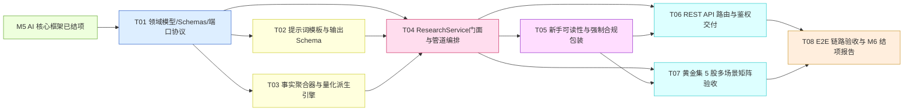

# M6 AI 用例 A：研究 / 买入决策 / 技术面 / 财报解读（research）任务总览与调度

> 协调者：Antigravity（统筹）｜执行：执行 Agent｜验收：协调者 + 用户
> 对应设计：[`docs/04-modules.md#m6`](../../04-modules.md)｜[`docs/02-architecture.md§5`](../../02-architecture.md)｜[`docs/03-data-model.md§3.4`](../../03-data-model.md)｜[`docs/05-api-spec.md§2.5`](../../05-api-spec.md)｜[`docs/06-ai-prompt-spec.md§4`](../../06-ai-prompt-spec.md)｜[`docs/08-test-plan.md§4.3, §5 M6`](../../08-test-plan.md)

**所有 Agent 必读**：[AGENTS.md](../../../AGENTS.md) → [CONTRACTS.md](CONTRACTS.md) → 自己的任务卡。

---

## 1. 任务清单

| ID | Issue | 任务名称 | 建议分支 | 依赖 | 规模 | 负责 Agent | 状态 |
|---|---|---|---|---|---|---|---|
| [T01](T01-domain-models-schemas-ports.md) | #117 | 领域数据模型、DTO Schemas 与端口协议（schemas & ports） | `feat/m6-t01-models-schemas-ports` | M5 已结项 | 中 | Antigravity | ✅ Merged (PR #125) |
| [T02](T02-prompts-and-output-schemas.md) | #118 | 提示词模板注册与输出 Schema 约束（4 大核心用例） | `feat/m6-t02-prompts-output-schemas` | T01 | 中 | Antigravity | ✅ Merged (PR #126) |
| [T03](T03-fact-aggregator-and-quantitative-engine.md) | #119 | 事实聚合器与代码量化派生引擎（Quantitative Metrics & Facts Aggregator） | `feat/m6-t03-fact-aggregator-quantitative` | T01 | 中 | Antigravity | ✅ Merged (PR #127) |
| [T04](T04-research-service-facade-and-pipeline.md) | #120 | 核心编排服务 ResearchService 门面与用例管道实现 | `feat/m6-t04-research-service-facade` | T01, T02, T03 | 中–大 | Antigravity | ✅ Merged (PR #128) |
| [T05](T05-novice-readability-and-compliance.md) | #121 | 新手可读性校验与强制合规包装器（Novice Readability & Compliance Guardrail） | `feat/m6-t05-novice-compliance` | T01, T04 | 中 | Antigravity | ✅ Merged (PR #129) |
| [T06](T06-rest-api-endpoints.md) | #122 | REST API 路由与端点交付（`/api/v1/ai/*` & `/api/v1/research/*`） | `feat/m6-t06-rest-api-endpoints` | T04, T05 | 中 | Antigravity | ✅ Merged (PR #130) |
| [T07](T07-golden-dataset-validation.md) | #123 | 黄金集 5 类代表性股票多场景集成验证（Golden Dataset Integration） | `feat/m6-t07-golden-dataset-validation` | T04, T05, T06 | 中 | Antigravity | ✅ Merged (PR #131) |
| [T08](T08-integration-acceptance-and-closeout.md) | #124 | 全链路端到端验收、文档与 M6 结项报告 | `feat/m6-t08-integration-acceptance` | T01–T07 | 中 | Antigravity | ✅ Merged (PR #132) |

---

## 2. 依赖图

---

## 3. 质量门禁与定义完成（DoD）

- **测试门槛**：`research` 模块单测覆盖率 $\ge 90.0\%$，全局覆盖率 $\ge 80.0\%$。
- **架构契约**：`lint-imports` 5/5 全部通过，严格遵守 `app.modules.research` 在 Layer 2 的分层边界。
- **防编造保障**：技术面进场/止损/目标数值与买入决策 52 周相对位置 100% 由代码计算并经 `FactTracingEngine` 验证。
- **静态检查**：`mypy app tests` 0 错误（严格类型检查）；`ruff check` 0 警告；`pip-audit` 0 安全漏洞。
