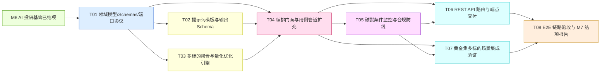

# M7 AI 用例 B：股票对比 / 长期持有 / 组合配置（comparison & portfolio）任务总览与调度

> 协调者：Antigravity（统筹）｜执行：执行 Agent｜验收：协调者 + 用户
> 对应设计：[`docs/04-modules.md#m7`](../../04-modules.md)｜[`docs/02-architecture.md§5`](../../02-architecture.md)｜[`docs/03-data-model.md§3.4`](../../03-data-model.md)｜[`docs/05-api-spec.md§2.5`](../../05-api-spec.md)｜[`docs/06-ai-prompt-spec.md§4`](../../06-ai-prompt-spec.md)｜[`docs/08-test-plan.md§4.3, §5 M7`](../../08-test-plan.md)

**所有 Agent 必读**：[AGENTS.md](../../../AGENTS.md) → [CONTRACTS.md](CONTRACTS.md) → 自己的任务卡。

---

## 1. 任务清单

| ID | Issue | 任务名称 | 建议分支 | 依赖 | 规模 | 负责 Agent | 状态 |
|---|---|---|---|---|---|---|---|
| [T01](T01-domain-models-schemas-ports.md) | #133 | 领域数据模型、DTO Schemas 与端口协议（compare, long_term, portfolio） | `feat/m7-t01-models-schemas-ports` | M6 已结项 | 中 | Antigravity | ✅ 已完成 (PR #141) |
| [T02](T02-prompts-and-output-schemas.md) | #134 | 提示词模板注册与输出 Schema 约束（3 大核心用例） | `feat/m7-t02-prompts-output-schemas` | T01 | 中 | Antigravity | 待开始 |
| [T03](T03-fact-aggregator-and-quantitative-optimization.md) | #135 | 跨标的事实聚合与代码量化优化引擎（指标分位打分与组合约束优化） | `feat/m7-t03-fact-aggregator-quantitative` | T01 | 中–大 | Antigravity | 待开始 |
| [T04](T04-service-facade-and-pipeline.md) | #136 | ResearchService 门面扩充与 M7 用例编排管道实现 | `feat/m7-t04-service-facade-pipeline` | T01, T02, T03 | 中–大 | Antigravity | 待开始 |
| [T05](T05-thesis-breaker-monitoring-and-compliance.md) | #137 | 论文破裂条件（thesis_breakers）监控元数据与合规包装器 | `feat/m7-t05-thesis-breaker-compliance` | T01, T04 | 中 | Antigravity | 待开始 |
| [T06](T06-rest-api-endpoints.md) | #138 | REST API 路由与端点交付（/compare, /long-term, /portfolio） | `feat/m7-t06-rest-api-endpoints` | T04, T05 | 中 | Antigravity | 待开始 |
| [T07](T07-golden-dataset-multi-stock-validation.md) | #139 | 黄金数据集多标的场景集成验证（横向对比、长投价值、投资组合全矩阵） | `feat/m7-t07-golden-dataset-multi-stock` | T04, T05, T06 | 中 | Antigravity | 待开始 |
| [T08](T08-integration-acceptance-and-closeout.md) | #140 | 全链路端到端验收、文档与 M7 结项报告 | `feat/m7-t08-integration-acceptance` | T01–T07 | 中 | Antigravity | 待开始 |

---

## 2. 依赖图

---

## 3. 质量门禁与定义完成（DoD）

- **测试门槛**：新增模块测试覆盖率 $\ge 90.0\%$，全局覆盖率 $\ge 80.0\%$。
- **架构契约**：`lint-imports` 5/5 全部通过，继续严守 Layer 2 边界。
- **防编造保障**：
  - 对比打分 100% 由代码分位算法生成；
  - 组合配置权重 100% 由代码优化算法派生，权重总和（含现金）严格恒等于 100%；
  - 长期论文破裂条件严格包含 `metric + threshold + data_field` 结构化元数据（$\ge 3$ 条）。
- **静态检查**：`mypy app tests` 0 错误（严格类型检查）；`ruff check` 0 警告；`pip-audit` 0 安全漏洞。
