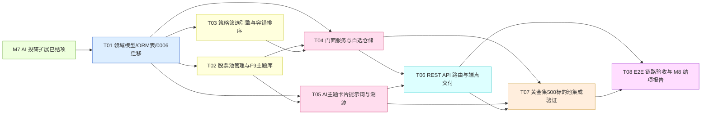

# M8 筛选器与主题自选（screener）任务总览与调度

> 协调者：Antigravity（统筹）｜执行：执行 Agent｜验收：协调者 + 用户
> 对应设计：[`docs/01-prd.md§F9, F10`](../../01-prd.md)｜[`docs/04-modules.md#m8`](../../04-modules.md)｜[`docs/02-architecture.md§5`](../../02-architecture.md)｜[`docs/03-data-model.md§3.4`](../../03-data-model.md)｜[`docs/05-api-spec.md§2.6`](../../05-api-spec.md)｜[`docs/06-ai-prompt-spec.md§4.8`](../../06-ai-prompt-spec.md)｜[`docs/08-test-plan.md§5 M8`](../../08-test-plan.md)

**所有 Agent 必读**：[AGENTS.md](../../../AGENTS.md) → [CONTRACTS.md](CONTRACTS.md) → 自己的任务卡。

---

## 1. 任务清单

| ID | Issue | 任务名称 | 建议分支 | 依赖 | 规模 | 负责 Agent | 状态 |
|---|---|---|---|---|---|---|---|
| [T01](T01-domain-models-orm-and-migration.md) | #149 | 领域数据模型、SQLAlchemy ORM 表与 Alembic 0006_screener 迁移 | `feat/m8-t01-models-orm-migration` | M7 已结项 | 中 | Antigravity | ✅ 已完成 (PR #157) |
| [T02](T02-universe-manager-and-themes.md) | #150 | 股票池服务（UniverseManager）与主题股票池库（F9 核心定义与预设配置） | `feat/m8-t02-universe-manager-themes` | T01 | 中 | Antigravity | ✅ 已完成 (PR #158) |
| [T03](T03-screener-executor-and-sorting.md) | #151 | 策略筛选引擎与容错并发执行器（ScreenerExecutor：批量策略扫描与确定性排序） | `feat/m8-t03-screener-executor-sorting` | T01 | 中–大 | Antigravity | ✅ 已完成 (PR #159) |
| [T04](T04-screener-service-and-watchlist-repo.md) | #152 | ScreenerService 核心门面与 Watchlist 仓储服务实现 | `feat/m8-t04-service-watchlist-repo` | T01, T02, T03 | 中–大 | Antigravity | ✅ 已完成 (PR #160) |
| [T05](T05-ai-theme-cards-prompts-and-schemas.md) | #153 | AI 主题股票卡片提示词模板注册与输出 Schema 约束（ThemeCards 提示词与防编造） | `feat/m8-t05-theme-cards-ai-prompts` | T01, T02 | 中 | Antigravity | ✅ 已完成 (PR #161) |
| [T06](T06-rest-api-endpoints.md) | #154 | REST API 路由与端点交付（/screener, /themes, /watchlists, /universes） | `feat/m8-t06-rest-api-endpoints` | T04, T05 | 中 | Antigravity | ✅ 已完成 (PR #162) |
| [T07](T07-golden-dataset-500-stocks-validation.md) | #155 | 黄金数据集大样本（500 标的池）策略筛选与多主题场景集成验证 | `feat/m8-t07-golden-dataset-500-stocks` | T04, T05, T06 | 中 | Antigravity | ✅ 已完成 (PR #163) |
| [T08](T08-integration-acceptance-and-closeout.md) | #156 | 全链路端到端验收（E2E）、文档与 M8 结项报告 | `feat/m8-t08-e2e-acceptance-closeout` | T01–T07 | 中 | Antigravity | ⏳ 待开始 |

---

## 2. 依赖图

---

## 3. 质量门禁与定义完成（DoD）

- **测试门槛**：新增模块测试覆盖率 $\ge 90.0\%$，全局覆盖率 $\ge 80.0\%$。
- **架构契约**：`lint-imports` 5/5 全部通过，继续严守 Layer 2 边界（screener 解耦底层，通过 ports 抽象访问）。
- **防编造保障**：
  - 策略筛选 100% 由代码策略引擎执行（F10）；
  - 主题股票卡片（Theme Cards）事实指标 100% 来自代码 facts，AI 生成后由 `FactTracingEngine` 严格溯源；
  - 排序算法完全确定可复现。
- **容错与隔离**：
  - 大股票池并发扫描单标的获取失败不阻断整个批次，准确计入 `failed_count`。
  - 多租户物理/逻辑隔离：自选表与筛选任务表严格包含 `user_id`。
- **静态检查**：`mypy app tests` 0 错误（严格模式）；`ruff check` 0 警告；`pip-audit` 0 安全漏洞。
