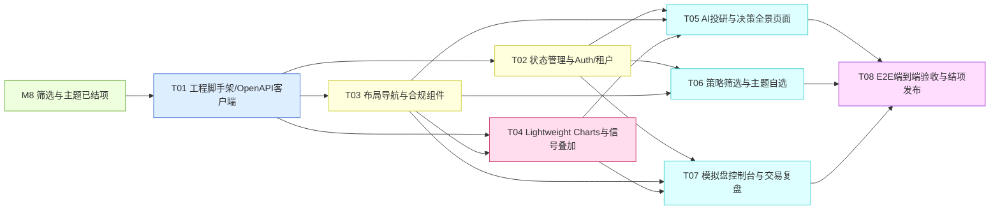

# M9 Web 前端（frontend）任务总览与调度

> 协调者：Antigravity（统筹）｜执行：执行 Agent｜验收：协调者 + 用户  
> 对应设计：[`docs/01-prd.md§4`](../../01-prd.md)｜[`docs/04-modules.md#m9-web-前端`](../../04-modules.md)｜[`docs/02-architecture.md§5`](../../02-architecture.md)｜[`docs/05-api-spec.md`](../../05-api-spec.md)｜[`docs/06-ai-prompt-spec.md`](../../06-ai-prompt-spec.md)｜[`docs/08-test-plan.md§5 M9`](../../08-test-plan.md)｜[`docs/09-adr.md#adr-017`](../../09-adr.md)

**所有 Agent 必读**：[AGENTS.md](../../../AGENTS.md) → [CONTRACTS.md](CONTRACTS.md) → 自己的任务卡。

---

## 1. 任务清单

| ID | Issue | 任务名称 | 建议分支 | 依赖 | 规模 | 负责 Agent | 状态 |
|---|---|---|---|---|---|---|---|
| [T01](T01-frontend-scaffolding-toolchain-openapi.md) | #165 | 前端工程脚手架、构建工具链与 OpenAPI TypeScript 客户端契约生成 | `feat/m9-t01-frontend-scaffolding-openapi` | M8 已结项 | 中 | Antigravity | ✅ 已完成 (PR #173) |
| [T02](T02-auth-identity-and-state-management.md) | #166 | 全局状态管理、用户认证体系与多租户上下文（Auth & Identity） | `feat/m9-t02-auth-identity-state` | T01 | 中 | Antigravity | ✅ 已完成 (PR #174) |
| [T03](T03-ui-components-layout-and-compliance.md) | #167 | 基础 UI 库与金融通用组件库（Theme, Layout, Nav, Cards, Compliance） | `feat/m9-t03-ui-layout-compliance` | T01 | 中 | Antigravity | ✅ 已完成 (PR #175) |
| [T04](T04-charting-lightweight-charts-and-signals.md) | #168 | 核心图表组件与行情交互（Lightweight Charts K 线与技术信号叠加） | `feat/m9-t04-lightweight-charts-signals` | T01, T03 | 中–大 | Antigravity | ✅ 已完成 (PR #176) |
| [T05](T05-ai-research-and-decision-views.md) | #169 | 投研分析与 AI 决策全景页面（Research, Buy Decision, Compare, Long-Term, Portfolio） | `feat/m9-t05-ai-research-decision-views` | T02, T03, T04 | 大 | Antigravity | ✅ 已完成 (PR #177) |
| [T06](T06-screener-themes-and-watchlists-views.md) | #170 | 策略筛选器与主题自选模块（Screener, Themes & Watchlists） | `feat/m9-t06-screener-themes-watchlists` | T02, T03 | 中 | Antigravity | ✅ 已完成 (PR #178) |
| [T07](T07-simbroker-console-and-journal-views.md) | #171 | 模拟盘全功能工作台与交易日志（SimBroker Console & Trading Journal） | `feat/m9-t07-simbroker-console-journal` | T02, T03, T04 | 中–大 | Antigravity | ✅ 已完成 (PR #179) |
| [T08](T08-frontend-e2e-acceptance-and-closeout.md) | #172 | 前端端到端验收（E2E）、Docker 容器化构建与 M9 结项报告 | `feat/m9-t08-frontend-e2e-closeout` | T01–T07 | 中 | Antigravity | 待开始 |

---

## 2. 依赖图

---

## 3. 质量门禁与定义完成（DoD）

- **技术规范**：React 18/19 + Vite + TypeScript (strict) + Tailwind CSS + TradingView `lightweight-charts`。
- **契约一致性**：前端 API 消费类型 100% 由后端 FastAPI OpenAPI 生成，杜绝手写 API 类型漂移。
- **合规标配**：所有 AI 呈现页面强制包含：
  1. 法定免责声明；
  2. 市场数据生成与快照时间（`as_of`）；
  3. AI 提示词与模型版本标识。
- **用户体验防线**：
  - 数据过期有明显 Warning 标记；
  - 任务加载中展现高逼真 Skeleton / Loading；
  - 配额耗尽（429）与预算熔断（503）具备友好操作指引；
  - 移动端友好响应式设计（自适应折叠布局）。
- **自动化测试**：单元测试、组件渲染测试与核心 E2E 测试链路全部通过。
